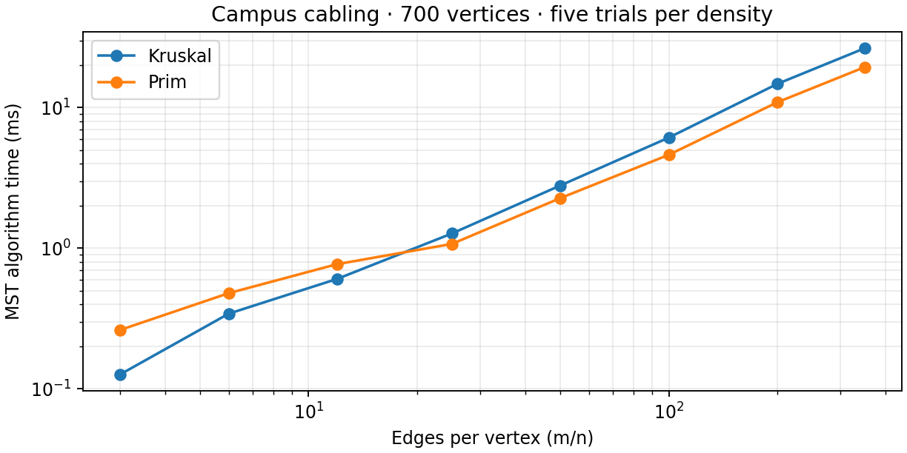
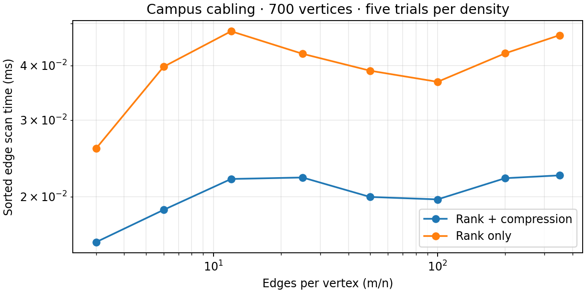
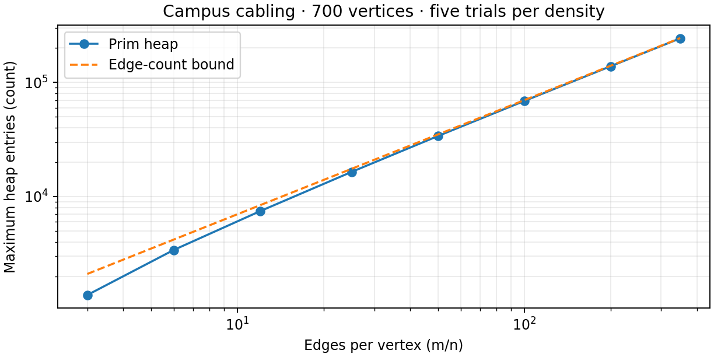

# Campus network cabling with minimum spanning trees

CS 203D · Project 4 · Team Campus (provisional)

## 1. Team and contributions

The [README](README.md) records the role and question assignments. Member names, roll numbers, verified GitHub identities, and links to individual commits are pending team input. The generated implementation assigns the code areas below to the corresponding review roles. [TOOLS.md](TOOLS.md) describes how the project materials were prepared.

- Structure A owner reviews heapsort, rank-based union-find, and Kruskal in src/structA.
- Structure B owner reviews the binary min-heap and lazy Prim in src/structB.
- Application owner reviews graph input, BFS, generation and zoning in app.
- Test owner reviews the certificate and CLI checks in tests.
- Measurement owner reviews the benchmark, plots and data.
- A sixth member, if present, owns the crossover analysis in Q6.

## 2. Problem and application

Buildings form the vertices of an undirected graph. The edge weights represent the cable costs of candidate links. Connecting every building with minimum total cost is the minimum spanning tree (MST) problem. Given a requested number of maintenance zones, the second objective is to maximize the cheapest candidate link between two different zones.

The program reads the edge list and builds an adjacency list. BFS starts at vertex 1 and records vertices when enqueued. If it cannot reach all vertices, the program reports DISCONNECTED. On a connected graph it builds an MST, sums its weights, and discards the k−1 heaviest tree edges. It labels the components of the remaining forest and prints the total and spacing on separate lines.

Random input generation uses a grid with cell width equal to the radius. A point within that radius must be in the current cell or one of eight neighboring cells, so comparisons are limited to those cells. The generator then checks the actual squared distance. It can still require quadratic comparisons and space when the point distribution and radius make the graph dense.

<!-- pagebreak -->

## 3. Structure A — Kruskal

The input stays in an array of edges. Kruskal copies the array and sorts it in place using a custom max-heap. The children of position i are at 2i+1 and 2i+2 when those positions exist. Bottom-up sifting makes the array a max-heap in O(E) time. Each subsequent step swaps the root with the last element of the active prefix and restores the heap in the smaller prefix. The suffix then contains the largest elements in nondecreasing order. The entire sort takes O(E log E) time and O(1) space beyond the copied array.

Kruskal sweeps the sorted array once. Disjoint-set representatives identify the current connected components. An edge is accepted only if its endpoints have different representatives. The sweep stops after V−1 successful unions. It skips loops and can select among parallel links of different costs. Equal-weight edges can appear in any order and are resolved by the component check.

### Representation and invariants

Union-find uses two arrays. A root points to itself and stores a rank. Every successful union links the smaller-rank root under the larger-rank root, increasing the receiving root’s rank only when both ranks match. Find first walks to a root and then, when enabled, rewrites parent links along the path. Every vertex stays in the same component during compression, and rank increases strictly along every nontrivial parent chain.

At the start of each scan step the accepted edges are a forest, and the union-find classes equal that forest’s components. Root comparison therefore answers the cycle query without another search through the graph. With both heuristics, the union-find work is O((V+E) α(V)) amortized. Rank alone gives O(log V) worst-case find time. Auxiliary storage for this implementation is O(V+E), including the copied edge list and returned tree.

### Design choice

Separate the sort from the sorted sweep. The application uses both steps. The benchmark prepares one sorted list per graph, then runs the same sweep with compression enabled and disabled. The rank comparison therefore measures the effect of the find strategy without including repeated sorting cost.

<!-- pagebreak -->

## 4. Structure B — Prim

Prim builds one tree from vertex 1. The adjacency list stores one arc at each endpoint for every undirected edge. Each arc stores an endpoint and the edge index, which lets the program recover the original weight and both endpoints when it accepts an edge.

Visiting a vertex marks it and inserts each incident edge whose other endpoint is still outside the tree. The binary min-heap stores candidates in a contiguous array. Insertion appends an entry and sifts it toward the root. Extraction replaces the root with the last entry, shrinks the array and sifts the replacement downward. In both directions the invariant is that each parent has weight at most that of its children. Neither operation requires a library priority queue or a search for an existing entry.

### Lazy deletion

Edges previously inserted toward a vertex stay in the heap after that vertex joins the tree. When such an edge reaches the root, the visited flag identifies it as stale. Every edge currently crossing the visited cut was inserted when its first endpoint was visited, and cannot have been removed while its other endpoint remained outside except by selection. The first live extraction is therefore a lightest crossing edge. The cut property establishes the invariant that the chosen edges extend to an MST.

### Cost and trade-off

There are at most E pushes and E pops. The heap peaks at no more than E entries. Prim takes O(V+E log(E+1)) time, which is O(E log V) on a connected simple graph. O(V+E) space covers the adjacency list, heap, flags and result. Parallel edges are supported on input, but their number can exceed the simple-graph edge bound used to simplify the logarithm.

Prim starts from one component and uses adjacency to avoid sorting all edge weights. Kruskal consumes a global edge ordering and can produce a forest covering all components if used without the CLI’s BFS guard. The application rejects disconnected inputs before invoking either structure.

<!-- pagebreak -->

## 5. Testing

The C++ tests exercise the three custom primitives directly. Heapsort output must be nondecreasing. A heap populated in reverse order must extract every key in sorted order. Rank-only and compressed union-find both join a balanced pattern of 64 elements, then agree on roots and reject unions within the same component.

### MST certificate

For each connected small graph and each structure, the test checks that the result contains exactly V−1 input edges, counted with multiplicity, and is connected. It independently computes the maximum weight on every tree path by traversing from every vertex. Each unused input edge must weigh at least as much as the maximum on the tree path between its endpoints. Otherwise swapping it for that maximum would reduce the cost. Conversely, if the test passes, take any other spanning tree and repeatedly exchange an edge outside the certified tree for a missing certified edge. Specifically, remove a missing certified edge from the certified tree to expose a cut. The other tree’s path between its endpoints contains a crossing edge outside the certified tree. Its certified tree path uses the missing edge, so replacing the crossing edge cannot increase the other tree’s cost. Each exchange increases the overlap, proving optimality.

### Zone certificate and reproducibility

For each solution, the test counts exactly k labels and scans the original graph for the smallest crossing edge. It also constructs the graph of all edges with weight at or below the reported spacing. That graph must have fewer than k connected components, because any split with strictly greater spacing would have to keep every such component together. This checks the upper bound independently of which MST edges were removed.

Seed 25304 produced 1,200 random cases, of which 800 were connected and certified for both algorithms. The remaining 400 deliberately isolate vertex 1. Targeted tests include a complete 200-vertex tied graph, parallel edges, a self-loop and extreme signed weights. CLI checks cover both structures and the 20,000-building demo, seed 253. No failing cases remained after verification. The recorded run did not identify a correctness bug.

<!-- pagebreak -->

## 6. Measurements — MST runtime

The benchmark ran under Linux x86-64 on an AMD EPYC 9V74 host with GCC 14.2.0, C++17 and -O2. It uses a steady clock and averages five runs per graph. Each density graph has 700 vertices, a planted random spanning tree and uniformly sampled remaining distinct pairs. All density graphs use seed 25304, with comparable integer weights in [1, 1000000]. The complete case has 244,650 edges.

The timed Kruskal call includes the edge-list copy, heapsort and sorted scan. The timed Prim call includes adjacency construction, including teardown, and the heap traversal. Input generation, BFS, zone splitting and result checks are excluded. The script alternates the order of the timed variants.

Kruskal led at 3, 6 and 12 edges per vertex. Prim led at 25 edges per vertex and every denser point measured. At 244,650 edges, Kruskal averaged 26.41 ms and Prim averaged 19.39 ms. Both curves rise with edge count. As density increases, Prim can finish with many entries still in the heap, while Kruskal’s heapsort must process the entire array even when its subsequent scan can stop early.

<!-- pagebreak -->

## 6. Measurements — union-find

The rank-only and rank-plus-compression variants process the same already-sorted edges, starting with fresh disjoint sets. Both stop once V−1 links are selected. The timer measures the whole sorted edge scan, including initialization and construction of the returned tree.

With path compression, mean scan times on the density sweep ranged from 0.016 to 0.022 ms. Rank-only means ranged from 0.026 to 0.048 ms. These small timings include allocation and clock overhead. The scans can stay roughly flat while input density rises because edges near the front already connect all vertices. Those measurements do not estimate an asymptotic exponent.

The generated 20,000-building case used side 10,000, radius 230 and seed 253. It had 325,806 edges. The sorted scan averaged 1.15 ms with compression and 3.01 ms without it. Raw measurements for all runs are in results/timings.csv.

<!-- pagebreak -->

## 6. Measurements — Prim heap

The peak is sampled after every batch of insertions when a vertex is visited. Heap size increases only during those batches, so this records the exact peak. The heap ended up holding as many as 243,241 entries on the 244,650-edge complete graph, about 99.4% of the edge count. The geometric case reached 269,048 live-or-stale entries.

The sweep shows that a dense graph can nearly reach the O(E) heap bound. Large queues incur memory and locality costs, while small graphs can spend proportionally more on constructing the adjacency list. The geometric graph averaged 32.24 ms for Kruskal and 52.46 ms for Prim despite lying near the crossover in edges per vertex. Density alone omits edge distribution, visited order, and the larger absolute working set.

<!-- pagebreak -->

## 7. Conclusion

For the measured geometric campus graph, Kruskal is the default choice. It was faster at the 20,000-building scale and the same sorted-scan implementation supported a direct comparison of union-find heuristics. Prim was faster on the denser 700-building cases, where it stopped after building the tree and avoided sorting every weight. A service that already maintains adjacency lists could have a different crossover because it can reuse that representation. Both structures use the same zoning logic and produced identical costs and spacings on the test suite.

The 20,000-building demonstration can be repeated with either structure using the README command. Both implementations report an MST cost of 931804 and a maximum eight-zone spacing of 115 for seed 253.

## 9. References

1. Course project brief, CS 203D Data Structures and Algorithms End Term Project, Project 4 and submission requirements.
2. J. B. Kruskal. “On the shortest spanning subtree of a graph and the traveling salesman problem.” Proceedings of the American Mathematical Society 7(1), 48–50 (1956).
3. R. C. Prim. “Shortest connection networks and some generalizations.” Bell System Technical Journal 36(6), 1389–1401 (1957).
4. R. E. Tarjan. “Efficiency of a good but not linear set union algorithm.” Journal of the ACM 22(2), 215–225 (1975).
5. T. H. Cormen, C. E. Leiserson, R. L. Rivest and C. Stein. Introduction to Algorithms, 3rd ed., Chapters 21 and 23. MIT Press (2009).
6. [Tool declaration](TOOLS.md), including the AI assistance used to prepare this submission.

<!-- pagebreak -->

## 8. Analysis appendix — Q1 and Q2

Drafted by Codex. The assigned team-member authors are pending.

### Q1. Cut property

Choose a lightest crossing edge e of any cut in a connected weighted graph, and let T be an MST. If e is already in T the claim holds. Otherwise adding e creates one cycle, consisting of e and the T path between its endpoints. That path starts and ends on opposite sides of the cut, so it has a crossing edge f distinct from e. Remove f to restore a spanning tree. Since w(e) ≤ w(f), the new tree weighs no more than T. Minimality of T makes the new tree an MST containing e. Equality permits the same argument for any tied lightest crossing edge.

### Q2. Kruskal, ties and cycle detection

Maintain the invariant that the already accepted forest F lies inside some MST T. The next accepted edge e joins two components. Consider the cut defined by one of those components. An earlier edge crossing the cut would have connected different components at the earlier step as well, because components only merge. It would have been accepted and could not cross the current cut. Thus e is lightest across the cut. No forest edge crosses this cut. Apply the exchange from Q1 to T and e, dropping a crossing edge outside F if needed. The new MST contains F plus e. After V−1 acceptances F itself is a spanning tree and therefore an MST.

An edge within one union-find component would close a cycle because a path already links its endpoints in F. An edge joining two components creates no cycle and triggers a union. The exchange uses a non-strict weight comparison, so any ordering among equal weights is valid.

<!-- pagebreak -->

## 8. Analysis appendix — Q3 and Q4

Drafted by Codex. The assigned team-member authors are pending.

### Q3. Rank bound and path compression

A root of rank r represents at least 2^r elements. Initially rank zero represents one. An unequal-rank union retains the higher rank and grows the receiving component. An equal-rank union combines two groups of at least 2^r elements and produces rank r+1. Hence every rank is at most floor(log2 V).

The rank strictly increases along every parent pointer between different vertices. The height is therefore at most floor(log2 V). Path compression reroutes vertices encountered by a find directly to their current root. This shortens later walks without altering the partition or the rank bound. With both heuristics, a sequence of operations costs amortized inverse-Ackermann time per operation after initialization.

### Q4. Prim with lazy deletion

Scanning adjacency lists costs O(V+E). Each undirected edge enters the heap at most once, when its first endpoint is marked and its other endpoint is unvisited. It can leave only once, either as a live crossing edge or as a stale edge. The peak has at most E entries, so each heap operation costs O(log(E+1)), yielding O(V+E log(E+1)). For a connected simple graph, V−1 ≤ E ≤ V(V−1)/2 and the expression simplifies to O(E log V). The heap bound remains E if parallel links are allowed.

<!-- pagebreak -->

## 8. Analysis appendix — Q5 and Q6

Drafted by Codex. The assigned team-member authors are pending.

### Q5. Optimal k-zone spacing

Sort the MST edges by nondecreasing weight. Keep the first V−k edges and remove the remaining k−1, with arbitrary ordering among ties. The kept forest has exactly k components. Let s be the lightest removed edge weight. Its endpoints are in different components, which gives a crossing edge of weight s. For any original edge crossing these components, the MST path between its endpoints uses a removed edge of weight at least s. A lighter crossing edge would improve the MST by replacing that removed edge. Thus the spacing of the forest partition is exactly s.

For the upper bound, reinstate one removed edge of weight s. The resulting forest has k−1 components and all its edges have weight at most s. In any partition into k nonempty zones, one such component must contain vertices from different zones. Some edge on their connecting path crosses between zones and has weight at most s. No split can exceed s. Ties affect the identities of zones while preserving the optimum spacing.

### Q6. Where Prim overtakes Kruskal

In the 700-vertex sweep Prim first led at 17,500 edges. At 8,400 edges, Kruskal took 0.61 ms and Prim 0.77 ms. At 17,500 edges they took 1.27 ms and 1.07 ms, respectively. The measured change lies between 12 and 25 edges per vertex. The exact crossover within the interval was not measured. At dense points, Kruskal always finishes the global sort. Prim can stop early with many entries still queued even though it paid to insert them. The 20,000-building result shows that the crossover is specific to the graph family and machine.
